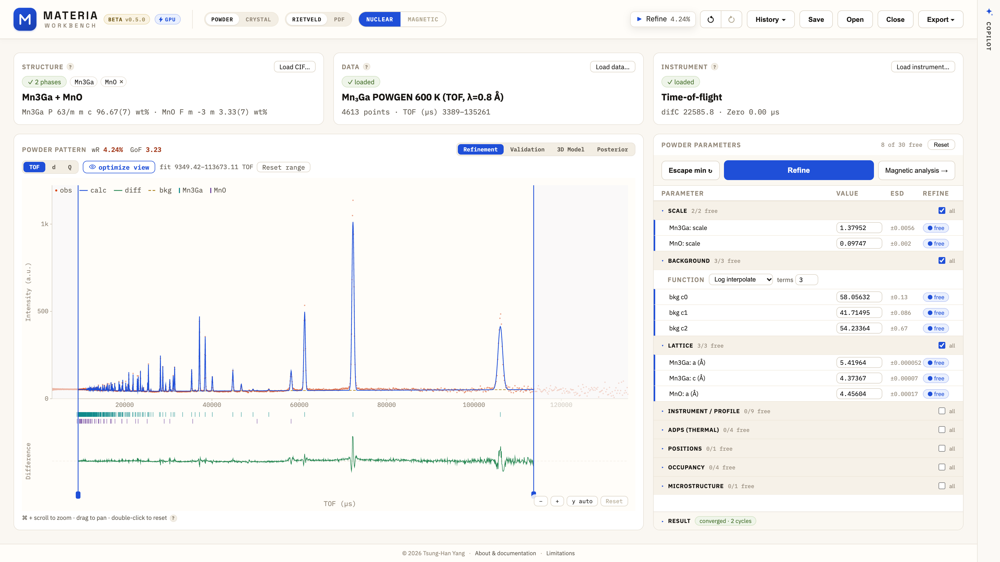

# MATERIA

[](https://drthyang.github.io/materia-platform/)
[](docs/LIMITATIONS.md)
[](LICENSE)

**Crystal and magnetic structure refinement in the browser, built to be driven by people and by AI agents.**
Rietveld, single-crystal F², magnetic structures and PDF/mPDF run on one TypeScript engine, with nothing
to install. The same engine backs the app, an in-app Copilot and an MCP server.

**▶ [Try it](https://drthyang.github.io/materia-platform/)**: the analysis runs on your machine. Two
demos open converged: a two-phase Mn₃Ga neutron TOF Rietveld fit and a GaTa₄Se₈ X-ray PDF fit.

<p align="center">
  
</p>

## What's new in 0.5.0

- **A subgroup engine of its own.** Irreps, isotropy subgroups and the subgroup lattice are built
  within a supercell bound (default 2×2×2), so zone-boundary children refine in their own cell on the
  PDF and Rietveld pages, with modes by parent irrep and ISODISTORT mode CIFs.
- **A redesigned Subgroups page and an Agent that lowers the symmetry** (`list_subgroups`,
  `lower_symmetry`, `clear_subgroup`), asking first.
- **Magnetic representation analysis at any commensurate k**, on the same engine.
- **Two fixes that change results:** a powder magnetic line now sums every member of its family, so
  domains of one group fit alike; irrep numbers follow one documented order on every runtime.
- **A Boxcar tab, a PDFgui / diffpy-CMI export and a context meter for the Copilot.**

Details and upgrade notes: [CHANGELOG](CHANGELOG.md#050---2026-11-07).

## Impact

- **One workflow for what usually takes several programs.** Powder and single crystal, X-ray and
  neutron (CW and TOF), nuclear and magnetic, reciprocal and real space, in a browser
  ([comparison with GSAS-II, Jana2020 and FullProf](docs/COMPARISON.md)).
- **Checked against the standard tools, on real data.** Each row names what a result was checked
  against. *Supported*: implemented and checked. *Approximate*: works, with a simplification to know.
  *Not yet*: not shown. Tolerances and tests are in [validation](docs/VALIDATION.md#external-comparisons),
  every gap in [limitations](docs/LIMITATIONS.md).

  | Area | Case | Checked against | Result | Status |
  | --- | --- | --- | --- | --- |
  | Single crystal | Ga/Al hydride, Mo Kα, SHELXL's 142 parameters | SHELXL | R1 2.02 % (2.04 %); Flack x 0.435(11) (0.435(15)); Al share 0.844(2) (0.844(2)) | Supported |
  | Magnetic intensities | Mn₃Ga 350 K, POWGEN neutron | GSAS-II | all 82 \|F_M\|² within ±5 % | Supported |
  | Moments and group | Mn₃Ga 30 K, monoclinic cell | GSAS-II | \|M\| of three Mn sites to 0.01 μB; P2₁′/m′ | Supported |
  | Magnetic group labels | MnO, every k = 0 subgroup of Fm-3m | FindSpinGroup | the same BNS labels | Supported |
  | Magnetic groups at k ≠ 0 | 15 parents and k, 0 and zone boundary | an independent construction, named by spglib | every candidate a group; the same classes and BNS numbers | Supported |
  | Subgroup lattice | Pnma, Pm-3m and Fm-3m in a supercell | Bilbao SUBGROUPS; brute-force enumeration | the same class counts (Pm-3m, I-centred 2c cell: 98 classes, 10 maximal); Fm-3m: the same 231 subgroups | Supported |
  | Modes by irrep | SrTiO₃ → R-3c and Pnma; NiAs → MnP-type Pnma | ISOTROPY; ISODISTORT 6.12.2 mode CIFs | per-irrep A_s to 4e-14; A_s and normfactor as ISODISTORT writes them | Supported |
  | Supercell child | four SrTiO₃ tilt systems | the whole supercell summed atom by atom | \|F\|² to 4e-12, G(r) to 7e-14 | Supported |
  | Incommensurate k | DyMn₆Ge₆ conical spiral, PSI DMC | FullProf | γ = 0.16478(67) (0.16509(43)); the cone's k = 0 part is not modelled, so wR 19.9 % (11.3 %) | Approximate |
  | PDF | Ni and MnO, X-ray G(r) | PDFfit2 1.6.0 | G_calc correlation 0.9998; refined cell within 2 mÅ | Supported |
  | Magnetic PDF | MnO and its measured tutorial data | diffpy.mpdf | f(r) to 10⁻¹¹ of its peak; ordered scale 1.6716 (1.6685) | Supported |
  | Posterior | the PDFfit2 Ni fit; exact Gaussian cases | LM esds; the exact posterior | posterior std / esd 0.95–1.01 | Approximate: correlated residuals ignored |
  | Does the Copilot help? | 8 held-out simulated cases with known answers | the app alone, fixed scoring | the app alone is right on 3 of 8; the Copilot's runs are in progress | Not yet |

  Reference values are in parentheses.
- **An AI analyst that shows its work.** The Copilot refines by your written method, and asks before
  every change, each one undoable. It reports with esds, and every number comes from the engine.
  Ten rounds with a crystallographer on real data shaped it
  ([researcher rounds](docs/VALIDATION.md#researcher-rounds)).
- **Agent-ready science.** An MCP server exposes the engine to any agent: parse → build →
  refine → assess → interpret ([agent tools](docs/AGENT_TOOLS.md)).

## What it does

| Track | Highlights |
| --- | --- |
| **Powder Rietveld** | CW and TOF, multi-phase, microstructure; GSAS-II, GSAS and FullProf instrument files; a FullProf / GSAS-II cross-check bundle |
| **Magnetic structures** | Magnetic peaks → k search → magnetic subgroups (BNS/OG) → moments; representation analysis at any commensurate k; commensurate and incommensurate single-k; mCIF. A powder line sums every member of its family, so magnetic domains fit alike |
| **Single crystal** | F² from hkl, SHELX and FullProf lists; extinction, twins, absolute structure |
| **PDF and mPDF** | Neutron and X-ray G(r), multi-phase and multi-dataset, magnetic PDF; a Boxcar tab with its own range and starting point; a PDFgui / diffpy-CMI export |
| **Subgroups** | Irreps, isotropy subgroups and the subgroup lattice within a supercell bound; a child refines in its own cell; modes by parent irrep, with ISODISTORT's A_s and A_p; ISODISTORT mode CIFs read and written; irrep labels in one documented order. The Subgroups page (PDF) opens on a Tree of maximal subgroups, with a merged List and one Activate |
| **Uncertainty** | Least-squares esds plus Bayesian posteriors (ensemble MCMC and NUTS), with Stop and Continue |

## The Copilot

**MATERIA Copilot** runs a model beside the analysis: a local one on Ollama or LM Studio, a cloud
model, or any OpenAI-compatible server.
It works on the powder page, its magnetic step, the single-crystal page and the PDF page, where it can
list subgroups and lower the symmetry. A meter by the message box shows how full the model's window
is, with Start fresh and Summarize and continue. Your method lives in skills it reads on demand, and
its firm rules are code. Each eval scenario replays one of its
past failures in CI ([evals](docs/AGENT_EVALS.md)). Passing them does not show it beats the app alone;
a controlled study of that is in progress ([protocol](docs/VALIDATION.md#does-the-agent-help)).
[Watch the 96 s demo](docs/media/agent-demo.mp4).

## Status

**Public beta.** Validate results intended for publication against established tools; see
[limitations](docs/LIMITATIONS.md) and the [roadmap](docs/ROADMAP.md).

## Develop

```bash
npm install
npm run dev
npm run test
```

Architecture, layering and the real-data regression: [docs/ARCHITECTURE.md](docs/ARCHITECTURE.md).
Every doc, by task: [docs/README.md](docs/README.md).

## License

[AGPL-3.0](LICENSE). If you run a modified version on a network server, you must make its source
available to its users (AGPL §13).

*This project is personal work, developed and maintained in my personal capacity.*
