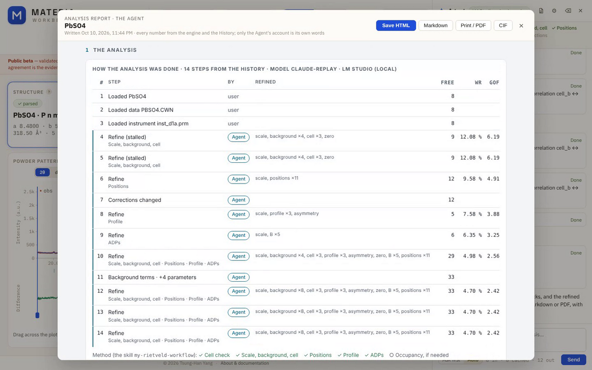

# MATERIA Workbench

[](https://drthyang.github.io/web-refinement/)
[](docs/LIMITATIONS.md)
[](LICENSE)
[](https://drthyang.github.io/web-refinement/)

**Crystal and magnetic structure refinement that runs entirely in your browser,
built to be driven by people and by AI agents.**

**An Agent works the analysis with you.** Open it beside a powder or PDF fit and
a model — Claude, or your own on Ollama or LM Studio — runs the refinement by
your written method, says why a fit is poor, names the phase behind an extra
peak, finds a magnetic structure, checks an unconvincing number with a Bayesian
posterior, and reports the result with esds. It asks before every change, or
works through the stages on its own in Auto. Its methods are skills it reads on
demand, its firm rules are code, and an eval suite replays the failures it once
had in CI. [How it works ↓](#the-agent)

**▶ Try it: [drthyang.github.io/web-refinement](https://drthyang.github.io/web-refinement/)** —
nothing to install, and the analysis runs on your machine (the Agent sends its
conversation to the model you choose: to Anthropic's API for Claude, nowhere
else for a local model). Two demos open already converged: a two-phase Mn₃Ga
neutron TOF Rietveld fit and a GaTa₄Se₈ X-ray PDF fit.

<p align="center">
  
</p>

## Goals

- **Refinement an agent can reason about.** Refinement is an expert loop, not a
  black box: free only symmetry-allowed parameters, watch correlations, judge the
  residuals. Every scientific function lives in a pure TypeScript core, so the
  same engine backs the UI buttons, the MCP agent tools and the in-app Agent. It
  returns what an agent needs to think with — correlations, near-null
  directions, at-bound flags — not just a scalar wR. See
  [The Agent](#the-agent) and [docs/AGENT_TOOLS.md](docs/AGENT_TOOLS.md).
- **One workflow, nothing to install.** Powder and single crystal, X-ray and
  neutron (constant-wavelength and time-of-flight), nuclear and magnetic,
  reciprocal and real space: one engine, one UI, on any OS with a browser. It
  reads the files you already have and complements GSAS-II, Jana2020 and
  FullProf rather than replacing them. See [docs/COMPARISON.md](docs/COMPARISON.md).
- **Transparent by design.** Fit quality is judged in a Validation view, not by
  wR alone: a verdict checklist, residual analysis (Durbin–Watson, cumulative
  χ², worst peaks) for powder, and SHELXL's analysis of variance for single
  crystal. Every result is cross-checked against
  established tools where possible, and the code is readable, tested TypeScript.
  See [docs/VALIDATION.md](docs/VALIDATION.md).

## Features

| Track | What you get | Read more |
| --- | --- | --- |
| **Powder Rietveld** | CW and TOF, multi-phase, background, peak shape, microstructure; GSAS-II, GSAS and FullProf instrument files; one-click FullProf / GSAS-II cross-check bundle | [User guide](docs/USER_GUIDE.md) |
| **Magnetic structures** | Detect magnetic peaks → k-vector search → magnetic subgroups with BNS/OG labels → moment refinement; k = 0, commensurate and incommensurate single-k; mCIF export | [Magnetic symmetry](docs/MAGNETIC_SYMMETRY.md) |
| **Single crystal** | F² refinement from hkl, SHELX HKL and FullProf `.int` lists, with absorption correction | [Single crystal](docs/SINGLE_CRYSTAL.md) |
| **PDF and mPDF** | Neutron and X-ray G(r), multi-phase and multi-dataset, boxcar scans across r, symmetry-mode distortions, magnetic PDF; validated against PDFfit2 and diffpy.mpdf | [PDF roadmap](docs/PDF_MPDF_ROADMAP.md) |
| **Uncertainty** | Levenberg–Marquardt esds plus Bayesian posterior sampling (ensemble MCMC and NUTS) with convergence diagnostics | [Refinement engine](docs/REFINEMENT_ENGINE.md) |
| **In-app Agent** | A model beside the analysis — Claude, or your own on Ollama or LM Studio — runs it by your method and discusses it; every change approved or undoable | [The Agent](#the-agent) |
| **Agent tools** | An MCP server over the same core (40 tools): parse → build → refine → assess → suggest → interpret | [Agent tools](docs/AGENT_TOOLS.md) |
| **Files** | Reads CIF/mCIF, hkl, `.int`, GSAS/FXYE/ILL/plain powder data, `.gr`/`.sq`/`.fq`; writes CIF/mCIF with esds, an HTML report, and a reopenable project file | [Project format](docs/PROJECT_FORMAT.md) |

## The Agent

The **Agent** button opens a model beside the analysis on screen: Claude through
an API key or the local proxy, or a model you run yourself on Ollama or LM
Studio. It reads the live page, judges the fit with the tools the MCP server
exposes, and changes things through the page's own controls, each change an
undoable History step. **Ask first** puts every change on an approval card;
**Auto** lets it work through the method's stages on its own and stop when a
decision is yours.

[](docs/media/agent-demo.mp4)

*[Watch the 80 s demo](docs/media/agent-demo.mp4) (MP4, 2.8 MB): the Agent refines
PbSO₄ against GSAS-II's D1A neutron tutorial data by the method's stages and writes
its report. The refinements, the checks and the report's numbers are computed live in
the browser; the Agent writes only its account. The model's turns follow a live run in which Claude did this
analysis through the app (shortened here: its Bayesian check of the B values is left
out) and are replayed through a local relay, which speaks LM Studio's API, so the
recording can be repeated; the stretch where the Agent works is shown at 3.2× speed.*

- **It runs the whole analysis, and talks it through.** The cell check (a Le Bail
  fit: unindexed peaks, shoulders, absences), the refinement stage by stage, why
  a fit is poor (`diagnose_fit`: background, positions, asymmetry, widths, the
  intensity fall-off, texture), which phase an extra peak is (`identify_peaks`:
  the sample environment and common standards), bond-valence sums, equal-value
  ties, antisite disorder, the magnetic structure (k, the magnetic space groups,
  the moments, the joint refinement) and boxcar scans of a PDF; then it reports
  the result with its esds and its own assessment, and answers questions about
  it. 43 tools across the powder page, its magnetic step and the PDF page.
- **A report you can hand on.** `write_report` opens the analysis report in the
  app, to save as HTML, Markdown or PDF with the CIF: the data and the model, the
  fit, the structure with esds, every parameter, and how the analysis went — the
  History's steps with what each refinement freed and the method stage behind
  it, the engine's checks (convergence, correlations, bounds, residual peaks,
  serial correlation, bond valences) with the issues left open, and the Bayesian
  check. Every number comes from the engine and the History; the Agent writes
  only its account, labelled as its words, and any number in it the report did
  not compute is underlined.
- **The Bayesian check when a number is not convincing.** `sample_posterior` runs
  the ensemble MCMC over the free parameters of a converged fit: credible
  intervals, limits where a value sits on a bound, the posterior correlations,
  and the probability that one value exceeds another. On Cr₂WO₆ it showed that
  the data do not tell the two cations' B apart, so one tied B is the model.
- **Your method, as skills read on demand.** The Rietveld workflow, the magnetic
  analysis, the PDF workflow, the symmetry review and the Bayesian check live in
  [`.claude/skills/`](.claude/skills). The system prompt carries their names and
  descriptions only; the Agent reads a skill when the task needs it, so a local
  model with a 32k context can follow it. Claude Code reads the same files.
- **Rules in code, not only in prose.** No change before the page's method has
  been read; no refinement of a parameter set that correlates at |ρ| ≥ 0.95,
  checked at the current values before every refine; no bare occupancy; the
  space group questioned only once the method's stages are refined. The stages
  show as a checklist in the drawer.
- **Tested on what it does.** Thirteen eval scenarios, each written against a failure
  a user or a researcher round found, replay the real chat loop and tools in CI
  with a scripted model — once as the Agent should behave and once as it
  failed, so every check is shown to catch its failure — and run against a real
  model on demand (`npm run eval:agent`).
- **Out of the way of the work.** The drawer sits beside the plot and the
  parameter table, not over them; the card the Agent is working on breathes, and
  the peaks it names are marked on the plot.

**Driven through real analyses.** In ten researcher rounds a crystallographer
put the Agent through an analysis end to end, and what it got wrong or could
not do was fixed:

| Round | Data | What it led to |
| --- | --- | --- |
| 1 | Mn₃Ga + MnO, POWGEN neutron TOF | residual peaks judged against each point's σ; misfits on known reflections kept apart from extra peaks |
| 2 | Mn₃Ga, CW neutrons, loaded from files | a cell check that holds on a 5–130° scan |
| 3 | GaTa₄Se₈, X-ray PDF | boxcar scans for local-versus-average questions |
| 4 | Mn₃Ga with an unannounced MnO impurity (simulated lab X-ray) | phase fractions with esds: 3.7 wt % read back as 3.65(8) |
| 5 | MgAl₂O₄ with 22 % inversion, from a normal-spinel CIF (simulated) | occupancy restraints in the fit; hold composition |
| 6 | PbSO₄, D1A neutrons (GSAS-II tutorial) | `diagnose_fit`, which found the missing peak asymmetry: wR 12 → 3.7 % |
| 7 | Fluorapatite, lab Cu Kα (GSAS-II tutorial) | the Kα₂ doublet and the polarization; the cell to 1 part in 10⁵ of GSAS's |
| 8 | Cr₂WO₆, neutrons at 150 K and 4 K | `identify_peaks`, `tie_parameters`, bond valences, the Bayesian check, d with the zero shift taken out, k = 0 found on wide lines, the moments kept through a settings change; in-plane moments, 2.28(2) µB in Pn′nm |
| 9 | LaMnO₃, NPDF neutron PDF (PDFgui tutorial) | PDFgetN files read as neutron data, and only their data; the PDF page's ADP model; bond lengths box by box in the boxcar scan and in the report; the Jahn–Teller distortion holds from the first box (1.5–6.5 Å) to the last |
| 10 | NAC (Na₂Ca₃Al₂F₁₄), 11-BM synchrotron | fluorite found and added as a known phase (1.448(6) wt %); the instrument file's asymmetry read; size, strain and phase fractions in the report; the 2009 profile ~¼ too broad in its Gaussian part, the sample adding next to nothing |

## Status

**Public beta.** Results intended for publication must be validated against
established tools and expert judgment; what is supported, approximate, or
missing is listed in [docs/LIMITATIONS.md](docs/LIMITATIONS.md). Next up: the
star of k and multi-k structures, full representation analysis, and a
symmetry-constrained local-spin model for mPDF. The build order is in
[docs/ROADMAP.md](docs/ROADMAP.md).

## Develop

```bash
npm install
npm run dev
npm run test
```

Build, lint, the real-data regression, and the layering rules are in
[docs/ARCHITECTURE.md](docs/ARCHITECTURE.md).

## Documentation

The full index, grouped by what you want to do, is
[docs/README.md](docs/README.md). Start with the
[user guide](docs/USER_GUIDE.md), and read the
[limitations](docs/LIMITATIONS.md) before you rely on a result.

## License

[GNU Affero General Public License v3.0](LICENSE). If you run a modified
version on a network server, you must make its source available to its users
(AGPL §13).

*This project is personal work, developed and maintained in my personal capacity.*
