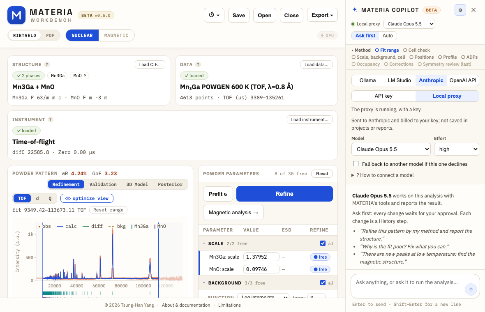
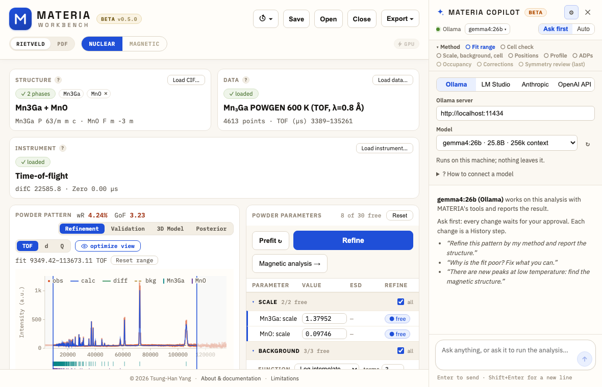

# Set up the Copilot

The MATERIA Copilot needs a language model to talk to. This page takes you
from nothing to a first answer, one connection at a time. For how each
connection works inside, see
[Five ways to reach a model](./AGENT_TOOLS.md#five-ways-to-reach-a-model).
For what the Copilot does once it answers, see the
[user guide](./USER_GUIDE.md#10-the-copilot).

Every step here was run before it was written. A step that was not run says
**not checked**. What was used is listed under [Checked on](#9-checked-on).

**Contents**

1. [Which way to pick](#1-which-way-to-pick)
2. [Anthropic API key](#2-anthropic-api-key)
3. [Local proxy](#3-local-proxy)
4. [Ollama](#4-ollama)
5. [LM Studio](#5-lm-studio)
6. [Any OpenAI-compatible server](#6-any-openai-compatible-server)
7. [First run](#7-first-run)
8. [Troubleshooting](#8-troubleshooting)
9. [Checked on](#9-checked-on)

## 1. Which way to pick

- **You use the [live site](https://drthyang.github.io/materia-platform/) and
  have an Anthropic API key:** [API key](#2-anthropic-api-key). Nothing to
  install.
- **You run the app yourself and do not want the key in the browser:**
  [Local proxy](#3-local-proxy). The key stays in a file on your machine.
- **You want a model on your own machine, with no key and no bill:**
  [Ollama](#4-ollama) or [LM Studio](#5-lm-studio). You need a machine that
  can run a model with a 32k context.
- **You have a key for OpenAI or Gemini, or run vLLM or a llama.cpp server:**
  [OpenAI-compatible server](#6-any-openai-compatible-server).

A hosted model follows a long method more reliably than a small local one.
With a local model, keep **Ask first** on.

### Where the settings are

1. Open the app and load data, or click a demo card such as
   **Mn₃Ga neutron TOF**.
2. Click the **Copilot** rail at the side of the page. On a phone, tap the
   **Copilot** bar at the bottom.
3. The settings are open the first time. Later, click **⚙**.
4. The top row picks the provider: **Ollama**, **LM Studio**, **Anthropic**
   or **OpenAI API**.

The chip under the title says which connection is in use, or what is missing
(**No API key**, **LM Studio · no model**). While something is missing, the
message box is disabled and says what to add.

## 2. Anthropic API key

Works on the live site and on a local server. The model runs at Anthropic and
is billed to your key.

1. Create a key in the [Anthropic Console](https://console.anthropic.com/)
   (**not checked**: no key was pasted into the browser for this manual; a
   real key was used only through the [local proxy](#3-local-proxy)).
2. In the Copilot settings, pick **Anthropic**, then **API key**.
3. Paste the key in **Anthropic API key**. The chip changes from
   **No API key** to **Anthropic API**, and the message box opens.
4. Pick the **Model** and **Effort**, or keep the defaults.
5. Send a first message ([First run](#7-first-run)).

### Where the key is kept

- The key goes from your browser to `api.anthropic.com` and nowhere else.
- By default it is kept for this tab only (the browser's session storage,
  under `materia.agent.apiKey`). It survives a reload. A new tab does not have
  it, and closing the tab drops it.
- Tick **Remember on this device** to keep it in this browser's local storage
  instead, under the same name. It then stays until you remove it. Leave this
  off on a shared computer.
- The key is not part of the saved settings, and the code never writes it to
  a project file, an autosave or a report.

### Check it works

Send a message. A wrong key answers:

> The API key was rejected. Check it in the Copilot settings.

### Remove the key

Clear the **Anthropic API key** field. The key is deleted from both storages
at once, and the chip goes back to **No API key**.

## 3. Local proxy

### What it is for

The local proxy is a small route in the app's own server. Your page sends its
requests to that route, and the server adds your key and forwards them to
`api.anthropic.com`. The key stays in a file or in the shell on your machine.
It never reaches the browser.

Use it when you run the app yourself and would rather not paste a key into a
web page.

- It exists only with `npm run dev` or `npm run preview`.
- The published site is a static build. It has no server, so it has no proxy.
- The model still runs at Anthropic and is billed to your key.

<p align="center">
  
</p>

### Install

You need [Node.js](https://nodejs.org/) 22 and git.

```bash
git clone https://github.com/drthyang/materia-platform.git
cd materia-platform
npm ci
```

### Give the server your key

Create a file named `.env.local` in the `materia-platform` folder, next to
`package.json`, with one line:

```bash
ANTHROPIC_API_KEY=sk-ant-your-key-here
```

Put your own key after the `=`. Git ignores this file, so it is not committed.

You can set the key in the shell instead of the file:

```bash
ANTHROPIC_API_KEY=sk-ant-your-key-here npm run dev
```

### Start the server

```bash
npm run dev
```

Then open the address it prints:

```
http://localhost:5173/materia-platform/
```

To serve the production build instead:

```bash
npm run build
npm run preview
```

That one prints `http://localhost:4173/materia-platform/`.

### Choose the proxy in the app

1. Open the Copilot settings ([where they are](#where-the-settings-are)).
2. Pick **Anthropic**, then **Local proxy**.
3. Read the line under the buttons. It says one of three things:
   - **The proxy is running, with a key.** You are ready.
   - **The proxy is running but has no key: …** The server did not find
     `ANTHROPIC_API_KEY`. See the failures below.
   - **This page has no proxy: …** This page is not served by `npm run dev`
     or `npm run preview`.

The chip reads **Local proxy** in all three cases. Go by the line in the
settings.

### Check it works

1. From a terminal, ask the proxy itself:

   ```bash
   curl http://localhost:5173/materia-platform/api/anthropic/health
   ```

   It answers `{"proxy":true,"key":true}`. `"key":false` means the server has
   no key.
2. Send a message ([First run](#7-first-run)). "With a key" only means a key
   was found. Whether the key is valid shows on the first message.

Checked with a real key, passed to `npm run dev` in the shell: one short
question to Claude Haiku 5.5 on the Mn₃Ga demo was answered in about four
seconds. Also run: the proxy with no key, the proxy with a placeholder key
(Anthropic refuses it), and a scripted conversation played through the proxy
route.

### Common failures

- **"The proxy is running but has no key"**, and a message answers "The proxy
  has no API key. …"
  Cause: no `ANTHROPIC_API_KEY`. Fix: check the file is named `.env.local`
  and sits next to `package.json`.
- **"The proxy's API key was rejected. Check ANTHROPIC_API_KEY where the dev
  server runs."**
  Cause: Anthropic refused the key. Fix: correct it in `.env.local`.
- **You edited `.env.local` and nothing changed.**
  `npm run dev` restarts by itself when the file changes. `npm run preview`
  does not: stop it (Ctrl+C) and start it again.
- **The address does not open.**
  If port 5173 is taken, `npm run dev` says "Port 5173 is in use, trying
  another one..." and uses the next (5174). Open the address it prints.
  Use `localhost` in the address: `http://127.0.0.1:5173/…` was refused on the
  machine used here.
- **"Blocked request. This host is not allowed."**
  Cause: the page was opened under another host name. The server and the
  proxy answer only for this machine's own names (`localhost`, a loopback
  address), so that another site cannot spend your key. Fix: open the app on
  the machine that runs the server, at `localhost`. Opening it from another
  device was **not checked**; from the code, the proxy refuses any host that
  the server's `allowedHosts` setting does not name.
- **"This page has no proxy: …"**
  Cause: the page is the published site or another static copy of the build.
  Fix: use `npm run dev` or `npm run preview`, or switch to
  [API key](#2-anthropic-api-key).
- **"Could not reach the proxy. …"**
  Cause: the server stopped. Fix: start it again and reload the page (from
  the code, **not checked**).

The dev server can also record a run and play it back without the API
(`MATERIA_RECORD`, `?agentReplay`):
[replays and recorded runs](./AGENT_TOOLS.md#five-ways-to-reach-a-model).

## 4. Ollama

A model on your own machine. No key, and nothing leaves the machine.

1. Install Ollama from [ollama.com](https://ollama.com/download) and start it.
2. Pull a model that can call tools and takes at least a 32k context. The
   app's own example:

   ```bash
   ollama pull qwen3
   ```

3. In the Copilot settings, pick **Ollama**. Keep **Ollama server** at
   `http://localhost:11434` unless yours is elsewhere.
4. Pick a model under **Model**. Each line shows the name, the size and the
   longest context, for example `gemma4:26b · 25.8B · 256k context`. A model
   marked **no tools** cannot be picked (from the code). **↻** asks the
   server again.

<p align="center">
  
</p>

### Local server or the live site

- **A page on `localhost`** (`npm run dev`, `npm run preview`): works with
  Ollama's defaults.
- **Any other address**, the live site included: Ollama refuses the page
  until you allow its origin. Start Ollama with `OLLAMA_ORIGINS` set to the
  page's origin, with no path:

  ```bash
  OLLAMA_ORIGINS=https://drthyang.github.io ollama serve
  ```

  If Ollama runs as the desktop app, set the variable the way
  [Ollama's FAQ](https://docs.ollama.com/faq) describes for your system, then
  restart the app (**not checked**).

  Checked: from a page on another `http` origin, the model list fails with
  the hint below, and an Ollama server started with `OLLAMA_ORIGINS` for that
  origin is reached. The live `https` site itself was **not checked**.

### Check it works

Send a short message ([First run](#7-first-run)). The first answer waits for
Ollama to load the model. The app asks for a 32k context, and its
instructions fill about half of that: the meter read **Context 49%** after
one short question.

### Ollama failures

- **"Could not reach Ollama at http://localhost:11434. Is it running (ollama
  serve, or the Ollama app)?"** Start Ollama, then click **↻**.
- **"… This page is served from …, so Ollama must also allow that origin:
  start it with OLLAMA_ORIGINS=…"** See the live-site step above. The message
  names the exact value to use.
- **"The server has no models. …"** Pull one.
- **"None of these models can call tools, …"** Pull a model that can (from
  the code).
- **"This model takes … tokens of context; … Expect it to lose track in a
  long session."** Pick a model with at least 32k (from the code).

## 5. LM Studio

A model on your own machine. No key, and nothing leaves the machine.

1. Install [LM Studio](https://lmstudio.ai/) 0.4.1 or later and download a
   model in it. One trained for tool use is best.
2. Start its server with CORS on. Either:
   - in LM Studio, open the **Developer** tab, start the server, and turn on
     **Enable CORS** in the server settings (**not checked** in the window;
     the command below was), or
   - run:

     ```bash
     lms server start --cors
     ```

   CORS is needed even for a page on `localhost`, because LM Studio's server
   has its own port. LM Studio warns that with CORS on, any website you visit
   can use its server. Stop the server when you are done: `lms server stop`.
3. In the Copilot settings, pick **LM Studio**. Keep **LM Studio server** at
   `http://localhost:1234` unless yours is elsewhere.
4. Pick a model under **Model**. Each line shows the name, the size, and
   **not loaded** or **loaded, …k context**.

### Context length

This part is **from the code, not run**: no model was loaded for this manual.

- A model that is not loaded: the Copilot loads it with a 32k context on your
  first message. The settings say so ("Not loaded yet: …").
- A model already loaded with less than 32k: the Copilot will not send to it,
  and says how to reload it. Eject it in LM Studio and send again, or run:

  ```bash
  lms unload <model>
  lms load <model> --context-length 32768
  ```

- The Copilot never unloads a model itself. Another program may be using it.

### Check it works

The model list filling in shows the server is reached (checked). Then send a
short message ([First run](#7-first-run)); expect a wait while the model
loads (**not checked**).

### LM Studio failures

- **"Could not reach LM Studio at http://localhost:1234. Is its server
  running, with CORS on? …"** The server is stopped, or it runs without CORS.
  Both give this same message. Start it with `lms server start --cors`, then
  click **↻**.
- **"… has no /api/v1/models. The Agent needs LM Studio 0.4.1 or later."**
  Update LM Studio (from the code).
- **"LM Studio's server asks for an API token. …"** Turn off **Require
  Authentication** in its server settings (from the code).

## 6. Any OpenAI-compatible server

For OpenAI, Gemini's OpenAI-compatible endpoint, vLLM, a llama.cpp server, or
any other server that speaks OpenAI's API.

This whole section is **from the code, not run**: no such server or key was
used for this manual.

1. In the Copilot settings, pick **OpenAI API**.
2. Pick a **Server** preset, or **Other** and type the **Base URL**. The
   address includes the `/v1`:
   - OpenAI: `https://api.openai.com/v1`
   - Gemini: `https://generativelanguage.googleapis.com/v1beta/openai`
   - vLLM: `http://localhost:8000/v1`
   - llama.cpp server: `http://localhost:8080/v1`
3. Paste the **API key** if the server needs one. It is kept as Anthropic's
   is: for this tab, or in this browser with **Remember on this device**
   (stored as `materia.agent.openaiKey`). It goes only to that server.
4. Pick a model under **Model on the server**. The list comes from the
   server's `/models`.
5. **Context (tokens)**: if the server reports the model's context, the field
   shows it and is locked. If not, set what the model takes. The default is
   32768, and below that the Copilot refuses long sessions.

**CORS.** The browser talks to the server directly, so the server must accept
requests from the page's origin. Start vLLM with `--allowed-origins` for the
page; a llama.cpp server allows any origin by default. A hosted provider must
accept requests from a web page.

### Server failures

- **"Could not reach …"** The server is down, the address is wrong, or CORS
  refuses the page.
- **"… refused the API key (401)."** Check the key.
- **"…/models answered 404: is this the server's OpenAI-compatible base URL
  (it usually ends in /v1)?"** Fix the address.

## 7. First run

1. Load a bundled demo: click **Mn₃Ga neutron TOF** on the start page.
2. Open the Copilot and check the chip names your connection.
3. Leave the switch on **Ask first**. A tool that only reads runs at once. A
   tool that changes the analysis shows a card and waits for **Approve** or
   **Decline**. **Auto** runs changes without a card, and goes back to
   **Ask first** when you reload.
4. Send a question that only reads:

   > In one sentence: which phase is loaded?

   The Copilot reads the analysis and answers that Mn₃Ga and MnO are loaded.
   With a local model on Ollama this took about 15 seconds on the machine
   used here.
5. Then ask for work, for example one of the suggestions in the empty chat:
   "Refine this pattern by my method and report the structure." Approve each
   step as its card appears. (Run here only as a scripted replay, with no
   model.)

The meter under the message box (for example **Context 49%**) shows how full the model's
window is; **New conversation** empties it.

More: [Ask first or Auto](./USER_GUIDE.md#ask-first-or-auto),
[your method](./USER_GUIDE.md#your-method-and-what-it-will-not-do),
[the context meter](./USER_GUIDE.md#the-context-meter).

## 8. Troubleshooting

Each entry: what you see, why, what to do.

- **The message box is disabled: "Add your API key in the settings first".**
  No key in API key mode. Paste one, or choose another connection.
- **The message box is disabled: "Pick a model in the settings first".**
  A local or OpenAI-compatible server is chosen with no model. Pick one. If
  the list is empty, the line under it says why.
- **"The API key was rejected."**
  Anthropic refused the key. Paste it again, whole.
- **"The proxy has no API key."**
  The server found no `ANTHROPIC_API_KEY`.
  [Give the server your key](#give-the-server-your-key).
- **"The proxy's API key was rejected."**
  Correct the key in `.env.local`. Restart `npm run preview` if you use it.
- **"This page has no proxy."**
  The page is a static build. Use `npm run dev`, or an API key.
- **"Could not reach Ollama …" / "Could not reach LM Studio …".**
  The server is not running, or it refuses this page's origin. See
  [Ollama](#ollama-failures) or [LM Studio](#lm-studio-failures).
- **"This API key is not allowed to use that model."**
  Pick another **Model** (from the code).
- **"Rate limited by the API."**
  Wait a moment and send again (from the code).
- **The key is gone after closing the tab.**
  That is the default. Tick **Remember on this device** to keep it.
- **Auto went back to Ask first.**
  It does on every reload.
- **A local model stops following the method or loses track.**
  Its window is full or the model is small. Check the context meter, start a
  **New conversation**, or use a larger model.

## 9. Checked on

- macOS 27.2.1, Node.js 24.16.0 (the project's CI uses Node 22; Node 22 was
  not run here), Vite 5.4.21.
- Browsers: Chromium 149 and WebKit (Safari's engine), both headless and
  driven by Playwright 1.61.1. Firefox and a phone were not run; a 390 px
  wide WebKit window was.
- Ollama 0.40.16 with `gemma4:26b`: model list, and one message.
- LM Studio 0.4.26: server start with and without CORS, model list. No model
  loaded.
- Anthropic: one live answer through the local proxy (Claude Haiku 5.5). A
  live answer in API key mode was not run.
- Not run: any OpenAI-compatible server, the live `https` site with a local
  model.
